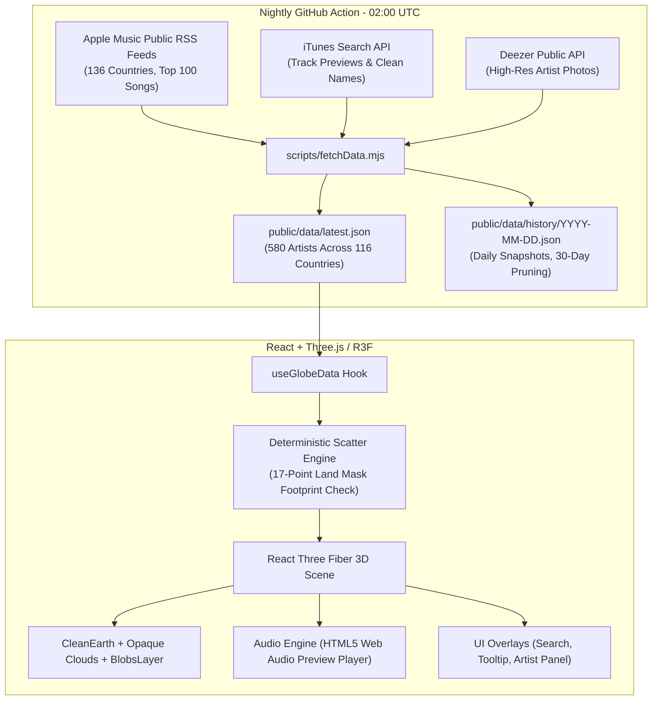

# 🌍 BobGlobe — Every Country's Top Artists, as Cute Blobs

<p align="center">
  
</p>

> **BobGlobe** is an interactive, tactile 3D globe where every country's most popular musical artists come alive as expressive, kawaii mochi creatures standing directly on a stylized cartoon Earth. Powered by nightly Apple Music country charts and enriched with Deezer artist photos, iTunes 30-second audio previews, and deterministic spatial placement, BobGlobe transforms dry music charts into an enchanting, explorable musical planet.

🔗 **Live Demo**: [LIVE_DEMO_URL](https://abdulrehman11tariq.github.io/BobGlobe/)

---

## 🤖 AI Assistance & Origin

- **Code & Architecture**: Built with AI coding assistance (**Antigravity** and **Claude**).
- **Brand Assets**:
  - The official brand assets (`public/brand/thumbnail-1500x1000.png`, `icon-512.png`, `favicon.png`) were programmatically rendered from our app's Three.js mochi blob geometries, palette, and procedural cartoon face textures.
  - The exploration illustrations in `public/brand/alt/` (`variant1.png` and `variant2.png`) were generated via an AI image generation model.

---

## ✨ Features (What Exists Today)

- **Expressive 3D Kawaii Blobs**: Procedurally modeled mochi blobs with cartoon facial expressions, directional head turns toward the camera, cute accessories (crowns for #1 artists, sprout leaves, cat ears, antennas, bows, caps), and idle breathing and boing spring animations.
- **100% Opaque & Crisp 3D Aesthetics**: High-performance, zero-transparency rendering featuring cartoon terrain textures, stylized 3D land relief, cartoon orbiting cloud clusters, and a cozy gradient space dome with twinkling white stars.
- **Accurate Geographic Scatter & Coverage**: Deterministic seeded layout algorithm with a 17-point footprint check placing **434 artists (74.8% international coverage across 116 charting nations)** without drifting into oceans or colliding across borders.
- **Rank 1 Country Placement Guarantee**: Every charting country is guaranteed placement for its #1 artist on valid territory land.
- **Hover & Tap Audio Previews**: Non-intrusive 30-second AAC audio previews fade in after a 350ms rest on desktop or tap on mobile, complete with live synchronized 100 BPM equalizer bars and progress indicators.
- **Artist Detail Panel & Deep Links**: Tap any artist blob to open a rich side panel featuring country rank, Apple Music top tracks with individual play/pause toggles, genre chips, and direct links to Apple Music and Deezer profiles.
- **Global Search & "Surprise Me" Explorer**: Instantly search across all 116 countries and 580 artists with keyboard navigation (`ArrowUp`, `ArrowDown`, `Enter`), or let the "Surprise Me" button fly the camera to a random country's top artist.
- **Global Top 10 Chart**: Dedicated leaderboard showcasing the overall top 10 artists worldwide based on cross-country chart dominance.
- **Deep Linking Support**: Share direct URLs containing `?artist=<id>` or `?country=<ISO>` to open the globe focused directly on any artist or country.
- **Zero-Key Public Data Pipeline**: Automated nightly scraping of public Apple Music RSS feeds and Deezer APIs without requiring third-party API keys.

---

## 🏗️ How It Works (Architecture)



---

## 📊 How the Data Works

### 1. Scoring & Blob Sizing Formula
Each country chart provides the top 100 songs in that country. An artist earns points for each song they place in the chart according to its position:
$$\text{points}(\text{rank}) = 101 - \text{rank}$$
An artist's in-country **chartScore** is the sum of points across all their charting songs:
$$\text{chartScore} = \sum_{s \in \text{songs}} (101 - \text{rank}_s)$$
To calculate physical 3D blob radius on the globe, an artist's relative dominance within their country is balanced with their country's relative weight in the global music market:
$$r = \frac{\text{chartScore}}{\text{countryTopScore}}, \quad w = \left(\frac{\text{countryTopScore}}{\text{globalMaxTopScore}}\right)^{0.4}$$
$$t = \sqrt{r} \times (0.5 + 0.5 \times w)$$
$$\text{radius} = (R_{\min} + (R_{\max} - R_{\min}) \times t) \times \text{BLOB\_SIZE\_BOOST}$$
This ensures the #1 artist in any country is prominently sized, while retaining global proportional context.

### 2. Countries Without Charts (`noChart`)
Out of 136 recognized countries in the base map, 20 countries currently do not have an active Apple Music public RSS chart feed (e.g., Cuba, North Korea, Iran, Somalia). In BobGlobe, these countries fail gracefully: they remain rendered on the 3D globe with country boundary outlines and search support, but without artist blobs or broken audio links.

### 3. Explicit Song Protection
Explicit songs flagged in Apple's feed (`contentAdvisoryRating: "Explicit"`) are strictly prevented from autoplaying on hover. When an explicit song is detected, the audio engine automatically falls back to the artist's next available clean track; if no clean preview exists, preview playback is safely suppressed and an advisory pill is displayed.

### 4. An Honest Note on Data Scope
BobGlobe visualizes **Apple Music's country charts**. While Apple Music provides wide international coverage across 116 markets, it does not represent total streaming across all platforms (e.g. Spotify, YouTube, physical sales, local radio). It offers a fascinating, unified snapshot of commercial streaming popularity by country.

---

## ⚖️ Compliance & Disclaimer

> **Disclaimer**: Not affiliated with or endorsed by Apple, Deezer or the artists. Hackathon project, non-commercial. Artist names, photos and audio previews belong to their owners.

- **Audio Previews**: Audio previews are streamed on-demand directly from Apple Music's preview CDN for 30-second non-commercial promotion. No audio files are downloaded, re-hosted, or stored in the repository.
- **Artist Imagery**: Artist photos and album artwork are dynamically hotlinked by URL from Deezer and Apple CDNs. No third-party artist photos or covers are committed or bundled in the deployment bundle.
- **Direct Linking**: All tracks link directly to Apple Music for full listening, and artist cards provide direct links to Deezer artist profiles.

---

## 💻 Tech Stack

- **Framework**: React 18 + TypeScript + Vite
- **3D Graphics**: Three.js, `@react-three/fiber`, `@react-three/drei`
- **Animation & Math**: `maath`, `@react-spring/three`
- **Styling**: Tailwind CSS
- **Icons**: `lucide-react`
- **Data & Geography**: Natural Earth 1:50m raster land masks and country borders
- **CI / CD**: GitHub Actions (Nightly Data Refresh + GitHub Pages Deployment)

---

## 🚀 Run Locally

### Prerequisites
- Node.js 20+
- npm 10+

### Setup
```bash
# Clone the repository
git clone https://github.com/abdulrehman11tariq/BobGlobe.git
cd BobGlobe

# Install dependencies
npm ci

# Run development server (opens at http://localhost:3000)
npm run dev
```

### Pipeline & Test Commands
```bash
# Run all unit tests (scatter footprint, landmark audit, elevation audit, data aggregation)
npm test

# Verify production data health (country coverage, artist scores, preview & photo completeness)
npm run verify-data

# Dry-run data fetch (tests Apple Music & Deezer endpoints without modifying files)
npm run fetch-data:dry

# Full data fetch (refreshes public/data/latest.json and writes daily snapshot)
npm run fetch-data

# Production build and typecheck
npm run build
```

---

## 🔄 Nightly Refresh Workflow

A GitHub Actions workflow (`.github/workflows/refresh.yml`) runs automatically every night at 02:00 UTC:
1. Scrapes the latest top 100 song charts across 136 countries from Apple Music RSS using a polite User-Agent.
2. Resolves clean artist names and 30-second AAC audio previews via the iTunes API.
3. Retrieves high-resolution artist images from Deezer.
4. Computes chart scores, ranks, and day-over-day trends (`up`, `down`, `same`, `new`).
5. Prunes snapshot files in `public/data/history/` older than 30 days.
6. Commits changes to `main` only if the data has updated.
7. Triggers the automated GitHub Pages deployment workflow (`.github/workflows/deploy.yml`) via `workflow_run`.

---

## 📸 Screenshots

| 3D Interactive Globe | Hover Preview Card |
| :---: | :---: |
|  |  |

| Artist Detail Panel | Global Search Explorer |
| :---: | :---: |
|  |  |

---

## 🔮 Known Limitations & Future Plans

- **Trend Indicators**: Rank movement trend arrows (`↑`, `↓`, `★`) require at least 2 consecutive days of snapshot history to populate; they will begin indicating weekly trends after the nightly action has run continuously.
- **Mobile WebGL Optimization**: While capped to DPR 1.5 on touch devices, low-end mobile GPUs may experience frame drops with 400+ animated blobs active; an optional LOD culling mode is planned.
- **Side-by-Side Compare Mode**: Comparing two nations' music taste side-by-side on split globes is planned for future releases.
- **Walk Mode**: First-person planetary exploration is planned for future major releases.

---

## 👏 Credits & Licenses

- **Music Charts & Metadata**: Apple Music Public RSS Directory & iTunes Search API (Previews provided courtesy of Apple Music / iTunes).
- **Artist Imagery**: Deezer Developer Platform (Dynamic CDN image delivery).
- **Geography & Land Boundaries**: [Natural Earth](https://www.naturalearthdata.com/) (Public Domain).
- **Typography**: [Plus Jakarta Sans](https://fonts.google.com/specimen/Plus+Jakarta+Sans) by Tokotype ([SIL Open Font License 1.1](https://openfontlicense.org/)).
- **Software Dependencies**: See [THIRD_PARTY_NOTICES.md](THIRD_PARTY_NOTICES.md) for full license notices covering Three.js (MIT), React Three Fiber & Drei (MIT), React (MIT), Lucide React (ISC), Vite (MIT), and other direct dependencies.

---

## 📄 License

MIT License. Free for educational and personal use.
